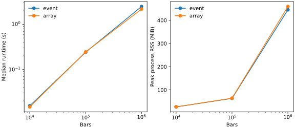

# Full-audit performance
On Linux, run the following from the checkout. The engine runner creates each deterministic input before timing, warms 1,000 bars and times one full simulation in a fresh process. Repeat three times per configuration. RSS includes the interpreter, inputs, allocator and outputs. The benchmark stores all marks and fills. CPU frequency, affinity, shared-host load and filesystem caches were uncontrolled. The pool study overlapped part of the second sweep; these are indicative results on one host.

    python benchmarks/engine.py --output benchmarks/results.json
    python benchmarks/pool.py > benchmarks/pool.json
    python benchmarks/report.py
    python -m cProfile -s tottime benchmarks/engine.py --worker 100000 array

[Per-size medians, throughput, scaling and speedup](table.md). [Raw samples and environment](results.json). [Before optimization](baseline.json).

Momentum periodically changes its target on a deterministic 40-bar sawtooth. Each million-row run produced equity 107 and 49,998 fills. Complexity is O(n) time and audit storage; the event momentum indicator uses O(L) auxiliary memory, while array signals use O(n). On 100k bars cProfile attributed 0.141 s internal time across 606,000 calls to the finite-check generator, versus 0.008 s inside target construction including warm-up. The revised loop checks finite values directly and computes the slipped price only on order submission. Million-row array median runtime changed from 2.780 to 2.185 s and median peak process RSS from 489.6 to 459.2 MiB. The optimized array path was slower than the event path on 100k rows.

For six candidates on 10k bars, a spawned two-worker pool took a median 0.330 s versus 0.092 s sequentially. The serialized bar list was 760,222 bytes. The 0.238 s excess wall time combines dispatch, startup, serialization and parallel work. It is not an isolated serialization measurement. Each worker receives its own copy. See pool.json for repetitions.
