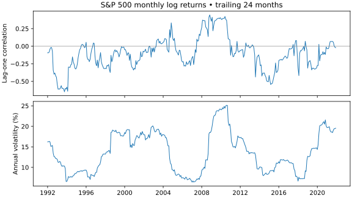

# S&P 500 monthly dependence

The study uses the ^GSPC series distributed with Matplotlib 3.10.8 in sample_data/Stocks.csv, whose header credits Yahoo Finance. The package supplies the input locally. Only derived statistics and a figure are published here. Check the original provider's terms for other uses. The monthly labels are period identifiers; treat observations as available after month end. The index series measures price changes and excludes reinvested dividends. No order is executed against these observations. The experiment uses the historical index series, without reconstructing it from today's constituents. ETF backtests require separately licensed, internally consistent OHLC, split and distribution handling.

Install Matplotlib 3.10.8, NumPy 2.3.5 and pandas (imported by the external estimator). From the project root:

    git clone https://github.com/Danylo16/man-fractal-analysis ../man-fractal-analysis
    git -C ../man-fractal-analysis checkout 443dcf119fbb710edf3676d4a0c6b5655ad177be
    python experiments/market.py ../man-fractal-analysis experiments

The original repository owns the R/S estimator. QuantForge owns input validation, the sampling design, surrogates, and the report. Fixed scales span 8–32 months. Compare the same estimator on returns, 99 shuffled surrogates and 99 randomly reordered nonoverlapping six-month blocks. Block permutation preserves order within a block and breaks dependence across its boundaries. These empirical reference intervals are descriptive, with finite-sample bias.

The estimate of 0.633 sits near the shuffled median (0.635). Both subsample estimates fall within their respective shuffled reference intervals. This experiment supplies little evidence for persistent long memory. The 15% volatility regime threshold uses the preceding 24 returns; regime averages are exploratory and cover different numbers of months.

